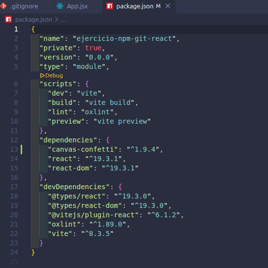
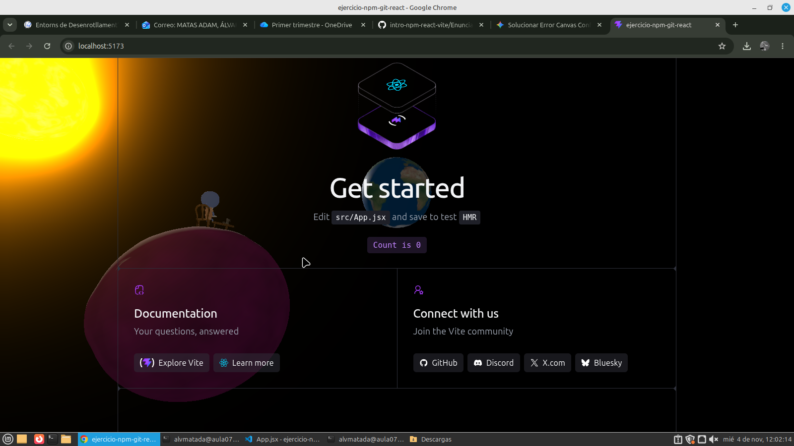

## Imagenes de la actividad

Imagen 1

Imagen 2

Imagen 3

Imagen 4

## Pregunta y respuesta

Si la carpeta node_modules/ está excluida, ¿borrar una dependencia hace alguna acción sobre el repositorio? ¿Cuál?

- Si la carpeta está bien excluida en el gitignore, al borrar una dependencia en local no hace nada sobre el repositorio de git.

## Enlace a la web desplegada
